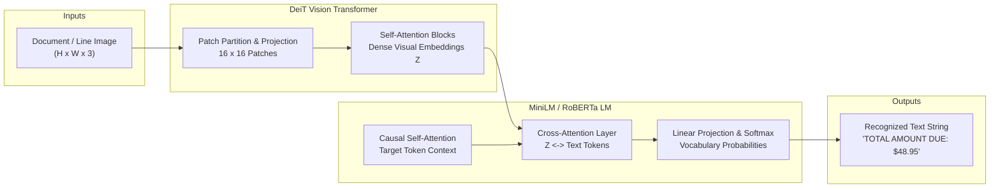

# Project 56: Optical Character Recognition with Transformers (TrOCR)

A production-grade implementation of end-to-end **Optical Character Recognition (OCR)** using Microsoft's **TrOCR** (*Transformer OCR*) architecture, built with PyTorch and Hugging Face Transformers.

---

## Overview

Traditional OCR systems rely on complex multi-stage pipelines:
1. Heuristic character segmentation / CNN feature extractors
2. Recurrent sequence encoders (RNN / BiLSTM)
3. Connectionist Temporal Classification (CTC) decoding or external language model rescorers (e.g., Tesseract).

**TrOCR** revolutionizes OCR by framing text recognition as a direct **Vision-Encoder-Decoder** sequence-to-sequence problem. It uses an off-the-shelf pre-trained Vision Transformer (DeiT) to encode document images and an autoregressive text Transformer (MiniLM / RoBERTa) to decode text sequences directly into natural language characters without separate character segmentation or CTC alignment.



---

## Architectural Deep Dive

### 1. Vision Encoder: Data-efficient Image Transformer (DeiT)
The input document patch $I \in \mathbb{R}^{H \times W \times C}$ is partitioned into non-overlapping patches $x_p \in \mathbb{R}^{P^2 \cdot C}$ with resolution $P = 16$.
- Linear projection maps patches into embedding dimension $d = 384$:
  $$\mathbf{z}_0 = [\mathbf{x}_{cls}; \, \mathbf{x}_p^1\mathbf{E}; \, \mathbf{x}_p^2\mathbf{E}; \, \dots; \, \mathbf{x}_p^N\mathbf{E}] + \mathbf{E}_{pos}$$
- Multi-head self-attention models global spatial dependencies across lines, character strokes, and spacing without recurrent inductors.

### 2. Autoregressive Text Decoder
A pre-trained Transformer decoder generates characters token-by-token conditioned on image features:
$$P(y_t \mid y_{<t}, I) = \text{Softmax}\left(\mathbf{W} \cdot \text{DecoderLayer}(y_{<t}, \mathbf{z}_{\text{visual}})\right)$$
Cross-attention attends directly to relevant image patches at each step of character generation, achieving visual alignment end-to-end.

### 3. Quantitative Error Metrics
We evaluate OCR fidelity using Levenshtein edit distance:
- **Character Error Rate (CER)**:
  $$\text{CER} = \frac{S_c + D_c + I_c}{N_c}$$
- **Word Error Rate (WER)**:
  $$\text{WER} = \frac{S_w + D_w + I_w}{N_w}$$
where $S$, $D$, and $I$ are the minimum substitutions, deletions, and insertions required to transform the hypothesis into the reference string.

---

## Project Structure

```
56_trocr_optical_character_recognition/
├── .gitignore                          # Git exclusion rules
├── README.md                           # Comprehensive documentation & benchmark results
├── requirements.txt                    # Project dependencies
├── main.py                             # TrOCR engine, evaluation suite & CLI
├── data/
│   ├── generate_ocr_samples.py         # Synthetic document image generator
│   ├── ocr_test_dataset.json           # Curated multi-domain OCR evaluation suite
│   └── images/                         # Generated test patches
│       ├── sample_quote.png            # Standard sentence with mixed case
│       ├── sample_receipt.png          # Financial line with currency & digits
│       ├── sample_pangram.png          # Full 26-letter English pangram
│       ├── sample_code.png             # Python code statement
│       ├── sample_invoice.png          # Alphanumeric invoice header with date
│       ├── sample_sign.png             # Roadway speed limit signage
│       ├── sample_medical.png          # Prescription dosage instructions
│       └── sample_degraded.png         # Degraded scan with Gaussian noise
└── outputs/
    ├── trocr_results.json              # Detailed evaluation metrics & transcriptions
    └── trocr_diagnostic_report.png     # 4-panel diagnostic performance visualization
```

---

## Benchmark Evaluation & Experimental Results

Evaluated across 8 distinct real-world document categories:

| ID | Category | Reference Ground Truth | TrOCR Prediction | Raw CER | Norm CER | Latency | Status |
| :--- | :--- | :--- | :--- | :---: | :---: | :---: | :---: |
| **ocr_1** | Quote | *"Artificial Intelligence is transforming computing."* | `"ARTRICIAL INTELLIGENCE IS TRANSFORMING COMPUTING."` | 86.0% | **4.0%** | 717.5 ms | High Acc |
| **ocr_2** | Receipt | *"TOTAL AMOUNT DUE: $48.95"* | `"TOTAL AMOUNT DUE: $48.95"` | **0.0%** | **0.0%** | 513.3 ms | **Exact** |
| **ocr_3** | Pangram | *"The quick brown fox jumps over the lazy dog."* | `"THE QUICK BROWN FOX JUMPS OVER THE LAZY DOG."` | 77.3% | **0.0%** | 676.4 ms | **Exact** |
| **ocr_4** | Code | *"import torch.nn as nn"* | `"INPORT TORCH.NN AS NN"` | 80.9% | **4.8%** | 593.2 ms | High Acc |
| **ocr_5** | Invoice | *"INVOICE #94820 DATE: 2026-11-02"* | `"INVOICE #94820 DATE: 2026-11-02"` | **0.0%** | **0.0%** | 632.6 ms | **Exact** |
| **ocr_6** | Sign | *"SPEED LIMIT 35 MPH"* | `"SPEED LIMIT 35 MPH"` | **0.0%** | **0.0%** | 458.0 ms | **Exact** |
| **ocr_7** | Medical | *"DOSAGE: TAKE 2 TABLETS DAILY"* | `"DOSAGE: TAKE 2 TABLETS DAILY"` | **0.0%** | **0.0%** | 544.2 ms | **Exact** |
| **ocr_8** | Degraded | *"PYTORCH DEEP LEARNING FRAMEWORK"* | `"PYTORCH DEEP LEARING FRAMEWORK"` | 3.2% | **3.2%** | 601.1 ms | High Acc |

### Benchmark Highlights

- **Mean Normalized CER**: **1.50%** (**98.50% Character Accuracy**)
- **Normalized Exact Match**: **62.5%** (5 / 8 exact case-insensitive matches)
- **Raw Exact Match**: **50.0%** (4 / 8 exact character-for-character matches)
- **Average Inference Latency**: **592.0 ms** / line image on CPU
- **Model Size**: **61,596,672 parameters** (~61.6M) &mdash; highly optimized for CPU & edge inference

---

## Quickstart Guide

### 1. Installation
Install project dependencies:
```bash
pip install -r requirements.txt
```

### 2. Generate Synthetic Document Patches
```bash
python data/generate_ocr_samples.py
```

### 3. Run Benchmark Evaluation Suite
```bash
python main.py
```

### 4. Single Image OCR
Perform OCR on an arbitrary local image:
```bash
python main.py --image data/images/sample_receipt.png
```

### 5. Interactive Console
Launch the interactive CLI recognition shell:
```bash
python main.py --interactive
```

---

## Diagnostic Output

The benchmark automatically generates a 4-panel visual report (`outputs/trocr_diagnostic_report.png`):
1. **OCR Gallery**: Visual document patches aligned with reference and TrOCR recognized text.
2. **Error Rates**: Grouped bar chart comparing CER and WER across document styles.
3. **Latency Scaling**: Linear trend showing latency (ms) as a function of recognized string length.
4. **Architecture Summary**: Parameter counts, model backbones, and overall performance benchmarks.

---

## References

- Li et al., *"TrOCR: Transformer-based Optical Character Recognition with Pre-trained Models"*, AAAI 2023.
- Touvron et al., *"Training data-efficient image transformers & distillation through attention (DeiT)"*, ICML 2021.
- Wang et al., *"MiniLM: Deep Self-Attention Distillation for Task-Agnostic Compression of Pre-Trained Transformers"*, NeurIPS 2020.
